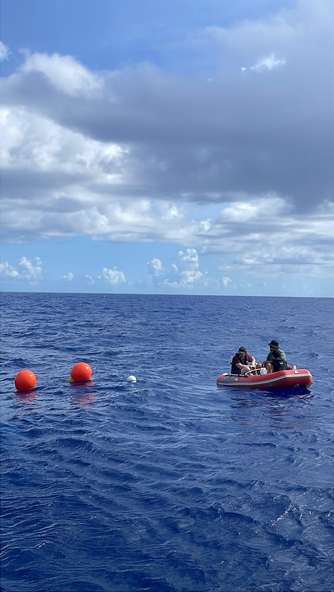

## Introduction
{:.no_toc}

This page contains deployment protocols. 

*Like ISAC, this page is a work in progress.*

## Table of Contents 
{:.no_toc}
* TOC
{:toc}

## Before You Leave
- [X] Burn [this sketch](https://github.com/KCollins/ISAC/blob/main/firmware/VCNL-universal-logger.ino) onto your logger boards.
- [ ] Download a local copy of the html file at https://kcollins.github.io/ISAC/OBS.html. Open it in a Chrome-based browser and verify that you can connect to a sensor.
### Packing Checklist
#### Tools for Drogue
- [ ] Line (Dyneema recommended)
- [ ] ***(3D printed blocks?)***
#### Tools for OBS sensors
- [ ] USB-A to micro-USB cable (make sure it carries data, not just power)
- [ ] USB-A to USB-C cable and charger for 3.6V batteries
- [ ] 3.6V battery in AA form factor, one for each sensor (bring extras)
- [ ] micro SD card, one for each sensor
- [ ] micro SD card reader
- [ ] ~~~crescent wrench (if using automotive plugs)~~~
- [ ] 3D printed wrench (if using threaded inserts)
- [ ] strap wrench
- [ ] ***(3D printed wrench)***
- [ ] Desiccant packets (silica gel, e.g.)
- [ ] Zip ties
- [ ] Teflon tape
- [ ] Electrical tape
- [ ] _Optional:_ Milk crate or bottle caddy to keep track of sensors.

## Sensor Deployment Protocol
- [ ] Open your local copy of the [HTML launcher](https://kcollins.github.io/ISAC/OBS.html) in a Chrome-based browser.
- [ ] Click "Connect to serial." You may have to refresh the page or hit "Connect" and then unplug/replug the USB cable for the port to appear. The number of the serial port will depend on how many USB devices have been connected to your computer. Only one thing can connect to a given serial port at a time, so make sure that the Arduino IDE is closed and no other instances of the launcher are open. Once the board is connected, the plot should appear and respond to light. Wave your hand over the sensor. 
- [ ] Enter a note in the text box (this will be recorded in the .CSV header) and make sure that the sampling cadence and LED power settings look good for your application. (Defaults: 100 ms, 200 mA.)
- [ ] Hit "Sync Time and Start Log File." Check the serial window to make sure that the file is indeed logging; if there are issues your micro-SD card may not be properly formatted or seated. Make sure the UTC timestamp looks good and take note of the filename.
- [ ] Insert the 3.7V battery into the holder on the board. Unplug the USB cable; the TX light should keep blinking.
- [ ] Gently insert the board back into the tube. Wrap the threaded insert in Teflon tape and tighten it with the 3D-printed wrench. **Do not overtighten!** The Teflon tape is very important; without it, your sensor _will_ flood.
- [ ] Put one or two fresh desiccant packets into the tube next to the sensor. These won't do much for you if your sensor floods, but they should help soak up condensate from the inside of the sensor being warmer than the outside. 
- [ ] Refresh the HTML launch page before repeating the process for the next sensor.
- [ ] Zip tie the sensor to the appropriate point in the column.

# Recovery
 - [ ] Use wrench to unscrew threaded insert. (If it's too tight, you may need to resort to a strap or pipe wrench; make sure to shield the PVC with a clean cloth in this case.) Check for water inside the housing. Update the table [here](_data/sensors.csv), which will be reflected in the [sensor inventory](https://kcollins.github.io/ISAC/OBS_list.html). If the sensor has failed, add details of when, where and how.
 - [ ] Remove battery and return it to charger.
 - [ ] Remove microSD card and put files into the [OBS_logs](../Data/OBS_logs) folder.
 - [ ] Return the microSD card to the board.
 - [ ] Run the Jupyter notebook [here](../Data/OBS_Reader.ipynb) to create plots of the data.

## Drogue Deployment Protocol
### Deployment
Fllowing a recently “pinged” location (lat/lon) of the ISAC instrumentation, the drifter is hand-deployed over the side of the vessel at a nominal 1 knot speed forward. The float is deployed first and using the slow drift forward and drag on the float, the column is extended at the surface and finally, the weight is dropped into the water, which sinks and orients the column vertically.
The position of the device is nominally tracked every 15 minutes over the entire deployment period (up to 24 hrs). 

### Water Sampling
Water sampling is conducted with a diaphragm pump.

### Recovery
Upon recovery, the vessel must use a grappling hook attached to a line to grab the float and pull it up onto the boat, careful to keep the drifter components away from the side of the vessel. 

---
